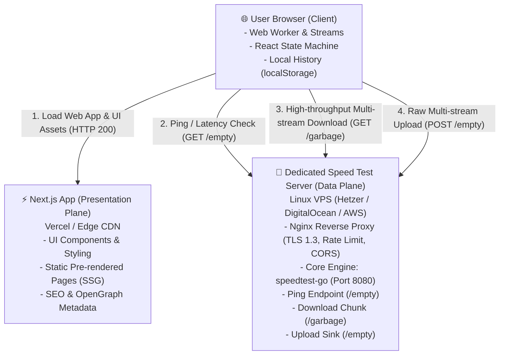

# ⚡ test-net — Internet Speed & Quality Connection Benchmark

[](https://nextjs.org/)
[](https://www.typescriptlang.org/)
[](https://tailwindcss.com/)
[](https://www.gnu.org/licenses/lgpl-3.0)
[](#)

> **test-net** adalah aplikasi web publik modern, ilmiah, dan berorientasi privasi untuk mengukur kecepatan dan kualitas koneksi internet secara langsung dari peramban (browser) tanpa iklan, tanpa pelacak, dan tanpa perlu mendaftar akun.

---

## 🎯 Nilai Utama & Filosofi Produk

* **Pengukuran Riil (Zero Fake Telemetry)**: Metrik dihitung murni dari transfer data aktual (byte streams) antara browser pengguna dan dedicated test server. Tidak ada angka simulasi atau generator acak.
* **Decoupled Architecture**: Memisahkan total lapisan antarmuka pengguna (Next.js App Router) dari data plane transfer bandwidth gigabit (Dedicated LibreSpeed Server).
* **Privacy by Design**: Tanpa basis data pengguna, tanpa cookies pelacak, dan tanpa penyimpanan riwayat pengujian di sisi server.
* **Scientific Metodology**: Pengukuran latency berbasis HTTP Round-Trip Time (RTT), perhitungan stabilitas variasi Jitter standar **RFC 3550**, dan transfer multi-stream konkuren.

---

## 🖼️ Tampilan Antarmuka (UI/UX Overview)

```
┌──────────────────────────────────────────────────────────────────────────────────┐
│  ⚡ test-net                 Primary Test Server (1 Gbps) 🟢     [About] [FAQ] [Docs]│
├──────────────────────────────────────────────────────────────────────────────────┤
│                                                                                  │
│                               TEST YOUR INTERNET                                 │
│                     Real-time actual network speed benchmark                     │
│                                                                                  │
│                         ╭──────────────────────────────╮                         │
│                         │        . - ~ ~ ~ - .         │                         │
│                         │    . '       ▲       ' .     │                         │
│                         │  /         /   \         \   │                         │
│                         │ :         |  GO |         :  │                         │
│                         │  \         \   /         /   │                         │
│                         │    . _       ▼       _ .     │                         │
│                         │        ' - , _ , - '         │                         │
│                         │                              │                         │
│                         │     [  START SPEED TEST  ]   │                         │
│                         │                              │                         │
│                         │   📍 Server: Singapore DC    │                         │
│                         │   Est. Data: ~20MB - 120MB   │                         │
│                         ╰──────────────────────────────╯                         │
│                                                                                  │
│   ┌─────────────────┬─────────────────┬────────────────┬─────────────────────┐   │
│   │    DOWNLOAD     │     UPLOAD      │      PING      │       JITTER        │   │
│   │   142.8 Mbps    │    45.2 Mbps    │     12 ms      │       1.8 ms        │   │
│   │   (3 Streams)   │   (Multi-XHR)   │   (Median RTT) │      (RFC 3550)     │   │
│   └─────────────────┴─────────────────┴────────────────┴─────────────────────┘   │
│                                                                                  │
│   Data transferred: 84.5 MB · [ 🔄 Test Again ] · [ 📋 Share Result ]            │
│   ▼ Local Test History (5 tests saved in browser memory)                         │
└──────────────────────────────────────────────────────────────────────────────────┘
```

---

## 🏗️ Arsitektur Sistem (Decoupled Architecture)



### Mengapa Next.js Dipisahkan dari Server Pengujian?
1. Next.js dirancang untuk perenderan antarmuka, optimasi bundle web, dan routing ringan—bukan sebagai *data plane* untuk transfer data biner berkecepatan gigabit.
2. Server pengujian khusus (*dedicated measurement engine*) dapat mengelola alokasi buffer TCP, concurrency socket, dan rate limiting secara terisolasi tanpa membebani aplikasi web utama.

---

## 📊 Metodologi Pengukuran

| Metrik | Formula / Metodologi | Standar / Keterangan |
| :--- | :--- | :--- |
| **Ping** | Median waktu kirim dan terima paket HTTP `GET /empty` (10 sampel) | Browser sandbox membatasi akses ICMP soket mentah; RTT HTTP mencerminkan latensi layer aplikasi nyata. |
| **Jitter** | $\text{Jitter} = \frac{1}{N-1} \sum_{i=1}^{N-1} \|\text{Ping}_{i+1} - \text{Ping}_i\|$ | Standar telekomunikasi **RFC 3550** untuk mengukur variasi stabilitas jaringan (ideal: < 5 ms). |
| **Download** | $\text{Mbps} = \frac{\text{Bytes Diterima} \times 8}{\text{Durasi Detik} \times 1\,000\,000} \times 1.03$ | 3 stream konkuren simultan mengunduh data biner acak `/garbage` (uncompressed, `gzip off`). |
| **Upload** | $\text{Mbps} = \frac{\text{Bytes Terunggah} \times 8}{\text{Durasi Detik} \times 1\,000\,000} \times 1.03$ | 3 stream paralel mengirim payload via `XMLHttpRequest` dengan pelacakan byte `upload.onprogress`. |
| **Data Usage** | Total Megabytes (MB) terkirim + diterima | Terhitung dan ditampilkan transparan secara real-time. |

---

## 🛠️ Tech Stack & Pustaka

* **Core Framework**: [Next.js 16](https://nextjs.org/) (App Router, Turbopack, Partial Prerendering)
* **Bahasa**: [TypeScript 5](https://www.typescriptlang.org/) (Strict Mode)
* **Styling**: [Tailwind CSS v4](https://tailwindcss.com/)
* **Komponen Primitif**: [shadcn/ui](https://ui.shadcn.com/) (Headless accessible primitives)
* **Ikonografi**: [Lucide React](https://lucide.dev/)
* **Engine Pengujian**: Dedicated [LibreSpeed](https://github.com/librespeed/speedtest) Server Core (`speedtest-go`)
* **Reverse Proxy**: Nginx (TLS termination, CORS headers, rate limiting)

---

## 📁 Struktur Direktori Project

```text
test-net/
├── app/                              # Next.js App Router
│   ├── layout.tsx                    # Root Layout (Geist Sans/Mono, Dark Mode, SEO)
│   ├── page.tsx                      # Dashboard Utama Speed Test
│   ├── globals.css                   # Tailwind v4 theme & token desain
│   ├── about/page.tsx                # Halaman Penjelasan Metodologi Ilmiah
│   ├── faq/page.tsx                  # Halaman Frequently Asked Questions
│   └── privacy/page.tsx              # Halaman Kebijakan Privasi
│
├── components/
│   ├── layout/                       # Navigasi & Footer
│   │   ├── app-header.tsx            # Header dengan status server pill
│   │   └── app-footer.tsx            # Footer & lisensi open-source
│   ├── speed-test/                   # Komponen Fitur Utama Pengujian
│   │   ├── speed-test-panel.tsx      # Dashboard utama interaktif
│   │   ├── circular-gauge.tsx        # Speedometer radial SVG & tombol GO
│   │   ├── metric-card.tsx           # Kartu metrik (Download, Upload, Ping, Jitter)
│   │   ├── test-progress.tsx         # Stepper fase & progress bar persentase
│   │   ├── local-history-drawer.tsx  # Riwayat pengujian lokal (localStorage)
│   │   ├── server-info.tsx           # Indikator nama server & enkripsi
│   │   ├── data-usage-notice.tsx     # Peringatan estimasi kuota data
│   │   └── error-message.tsx         # Alert error koneksi & tombol coba lagi
│   └── ui/                           # Primitif shadcn (Button, Card, Badge)
│
├── hooks/
│   └── use-speed-test.ts             # State Machine Hook pengujian koneksi
│
├── lib/
│   ├── config.ts                     # Konfigurasi environment & server URL
│   ├── utils.ts                      # Utility styling `cn()`
│   └── speed-test/
│       ├── types.ts                  # Kontrak tipe domain & interface adapter
│       ├── constants.ts              # Nilai default durasi & label fase
│       ├── calculations.ts           # Formula throughput, jitter RFC 3550, data usage
│       ├── real-engine-adapter.ts    # Adapter pengukuran data plane nyata
│       ├── local-history.ts          # Sinkronisasi browser localStorage
│       └── service.ts                # Factory provider engine adapter
│
├── infra/
│   └── speedtest-server/             # Blueprint Deployment Dedicated Server
│       ├── docker-compose.yml        # Orchestration LibreSpeed + Nginx
│       ├── nginx.conf                # Konfigurasi Nginx (TLS, CORS, Rate Limit)
│       ├── local-server.mjs          # Server pengujian lokal berbasis Node.js
│       ├── .env.server.example       # Template environment server
│       └── README.md                 # Panduan deployment VPS Linux
│
├── tests/
│   └── run-suite.mjs                 # Automated unit & functional test runner
│
├── docs/                             # Dokumentasi Arsitektur Resmi Proyek
│   ├── TECHNICAL_PLAN.md             # Dokumen teknis 22 bab (Phase 2)
│   ├── UI_UX_GUIDE.md                # Panduan desain & wireframe (Phase 3)
│   ├── TEST_REPORT.md                # Laporan audit QA, keamanan, performa (Phase 9)
│   ├── DEPLOYMENT_GUIDE.md           # Panduan rilis produksi (Phase 10)
│   └── RELEASE_NOTES.md              # Catatan rilis v1.0.0 (Phase 10)
│
├── .env.example                      # Template variabel lingkungan
├── package.json                      # Konfigurasi skrip & dependensi
└── README.md                         # Dokumentasi utama proyek
```

---

## 🚀 Panduan Memulai Cepat (Quick Start Guide)

### 1. Prasyarat Sistem
* [Node.js](https://nodejs.org/) `>= 20.x LTS`
* [npm](https://www.npmjs.com/) `>= 10.x`

### 2. Instalasi Dependensi
```bash
cd test-net
npm install
```

### 3. Konfigurasi Variabel Lingkungan
Salin file template konfigurasi:
```bash
cp .env.example .env.local
```
Isi default pada `.env.local` sudah dikonfigurasikan untuk server pengujian lokal:
```env
NEXT_PUBLIC_SPEEDTEST_SERVER_URL=http://localhost:8080
NEXT_PUBLIC_SPEEDTEST_SERVER_NAME="Local Test Server"
NEXT_PUBLIC_TEST_DURATION_DL=8
NEXT_PUBLIC_TEST_DURATION_UL=8
NEXT_PUBLIC_TEST_PING_SAMPLES=10
```

---

## 🧪 Menjalankan Pengujian Lokal (Cara Mengetes)

Untuk menguji pengujian kecepatan internet secara nyata di laptop/komputer Anda, buka **2 terminal**:

### Terminal 1: Jalankan Dedicated Speed Test Server
Jalankan server pengujian lokal berkecepatan tinggi (berbasis Node.js murni, tanpa perlu Docker):
```bash
cd test-net
node infra/speedtest-server/local-server.mjs
```
> Server akan aktif di `http://localhost:8080` dan mengekspos endpoint `/empty`, `/garbage`, dan `/getIP`.

### Terminal 2: Jalankan Frontend Web App
```bash
cd test-net
npm run dev
```
> Aplikasi web akan aktif di `http://localhost:3000`.

### Buka di Browser
Akses **`http://localhost:3000`** di browser Anda, lalu:
1. Tekan tombol **GO** untuk memulai pengujian.
2. Amati pengukuran berjalan: **Ping & Jitter** $\rightarrow$ **Download Multi-stream** $\rightarrow$ **Upload XHR** $\rightarrow$ **Completed**.
3. Coba tekan tombol **Cancel Test** saat pengujian berjalan untuk menguji fitur pembatalan instan.
4. Tekan **Share Result** untuk menyalin teks ringkasan ke clipboard.
5. Periksa **Local Test History** di bawah panel untuk melihat riwayat tes yang tersimpan otomatis di browser Anda.

---

## 📜 Skrip npm yang Tersedia

| Command | Fungsi |
| :--- | :--- |
| `npm run dev` | Menjalankan development server Next.js di `localhost:3000` |
| `npm test` | Menjalankan automated test suite (kalkulasi throughput, jitter, dsb.) |
| `npm run lint` | Menjalankan audit static code analysis dengan ESLint |
| `npx tsc --noEmit` | Memeriksa integritas tipe TypeScript (*Strict Type Checking*) |
| `npm run build` | Mengompilasi aplikasi untuk lingkungan produksi (*Static Prerender*) |
| `npm run start` | Menjalankan hasil build produksi lokal |

---

## 🌐 Panduan Deployment ke Produksi (Production)

### 1. Web Frontend (Vercel)
1. Hubungkan repositori GitHub project ini ke akun [Vercel](https://vercel.com/).
2. Atur *Root Directory* ke `test-net`.
3. Masukkan Environment Variable produksi:
   ```env
   NEXT_PUBLIC_SPEEDTEST_SERVER_URL=https://speed.yourdomain.com
   NEXT_PUBLIC_SPEEDTEST_SERVER_NAME="Singapore Gigabit Server"
   ```
4. Klik **Deploy**.

### 2. Dedicated Speed Test Server (Linux VPS)
1. Sewa VPS Linux (Ubuntu 22.04 LTS) dengan alokasi bandwidth gigabit port 1 Gbps.
2. Buat sertifikat SSL Let's Encrypt menggunakan Certbot:
   ```bash
   sudo certbot certonly --standalone -d speed.yourdomain.com
   ```
3. Salin folder `infra/speedtest-server/` ke VPS dan jalankan:
   ```bash
   docker compose up -d
   ```
4. Verifikasi endpoint aktif:
   ```bash
   curl -I https://speed.yourdomain.com/
   curl -i https://speed.yourdomain.com/empty
   ```

*Panduan deployment lebih terperinci dapat dibaca pada [docs/DEPLOYMENT_GUIDE.md](docs/DEPLOYMENT_GUIDE.md).*

---

## 🏆 Rekapitulasi 10 Fase Sekuensial Pengembangan

Project ini dibangun secara bertahap melalui metodologi **10 Development Phases**:

| Phase | Nama Fase | Output & Deliverable Kunci | Commit Git |
| :---: | :--- | :--- | :--- |
| **0** | Pre-Flight & Discovery | Audit lingkungan lokal, Node v22, Git status | Checkpoint baseline |
| **1** | Project Bootstrap | Setup Next.js 16, TypeScript, Tailwind, shadcn/ui | `phase 1: project bootstrap` |
| **2** | Technical Architecture | Validasi LibreSpeed LGPL-3.0, arsitektur teknis | `phase 2: technical architecture` |
| **3** | UI/UX & Design System | Wireframe desktop/mobile, token desain, UI states | `phase 3: ui ux planning` |
| **4** | Frontend Foundation | Layout, Navbar, Footer, MetricCard, halaman rute | `phase 4: frontend foundation` |
| **5** | Core Frontend Features | State machine hook, CircularGauge radial, mock adapter | `phase 5: core frontend features` |
| **6** | Backend Infrastructure | Dedicated server, Nginx TLS, Rate limiting, CORS | `phase 6: backend implementation` |
| **7** | Integration | Real engine adapter, pelepasan mock, pengujian E2E | `phase 7: frontend backend integration` |
| **8** | Product Completion | About, FAQ, Privacy, Share Result, Local History | `phase 8: additional features` |
| **9** | QA & Security Audit | Test matrix FR-01 s/d FR-12 (100% PASS), TEST_REPORT | `phase 9: testing and optimization` |
| **10** | Production Release | Deployment Guide, Release Notes v1.0.0, Release Tag | `phase 10: production deployment` |

---

## 📄 Lisensi & Atribusi Open Source

* **test-net Application**: Dilisensikan di bawah ketentuan lisensi MIT / LGPL-3.0.
* **LibreSpeed Measurement Core**: Protokol dan engine pengukuran didasarkan pada proyek open-source [LibreSpeed](https://github.com/librespeed/speedtest) yang berlisensi **GNU Lesser General Public License v3.0 (LGPL-3.0)**.

---

*test-net — Built with precision, transparency, and speed.*
