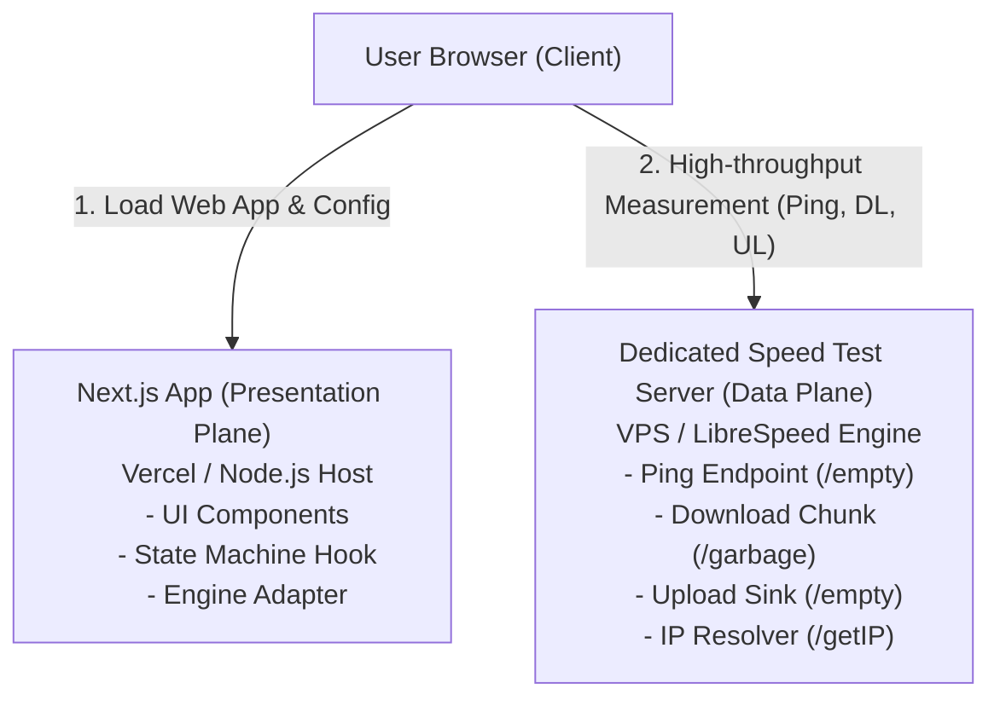
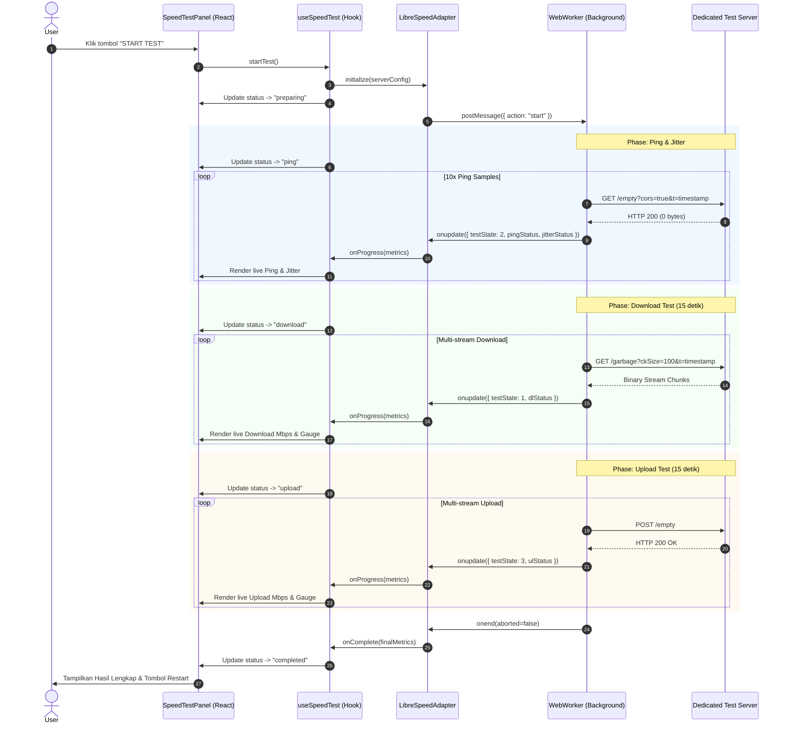
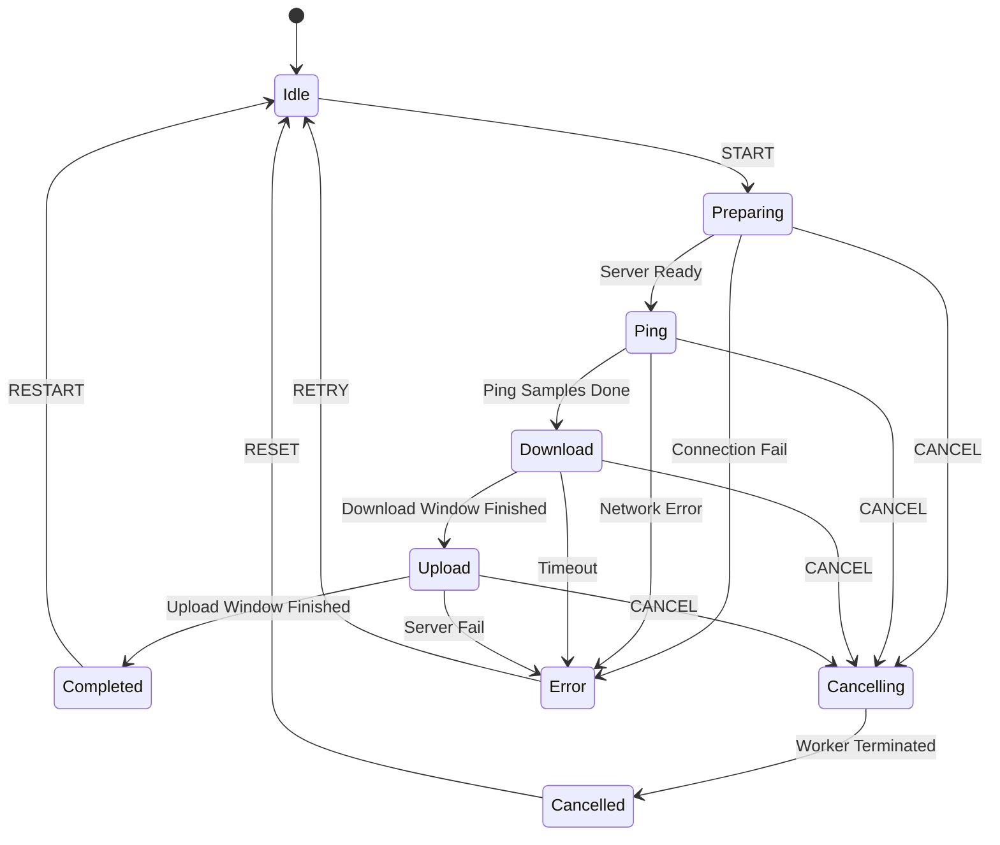

# test-net — Technical Planning & Architecture Document

Dokumen ini merupakan spesifikasi arsitektur teknis resmi untuk pengembangan sistem **test-net**, platform pengujian kualitas dan performa koneksi internet publik. Dokumen ini menjadi acuan tunggal implementasi teknis untuk fase-fase berikutnya.

---

## 1. Architecture Overview

`test-net` mengadopsi arsitektur **Decoupled Architecture (Pemisahan Total Presentation Plane dan Measurement Data Plane)**.



### Prinsip Utama Arsitektur:
1. **Zero Data Payload on Next.js**: Next.js serverless/edge route handlers tidak boleh digunakan sebagai data plane untuk transfer payload speed test (mencegah bandwidth hogging, latency bottleneck, dan tagihan serverless tak terkendali).
2. **Dedicated Data Plane**: Dedicated measurement server mengelola concurrency, rate limiting, TCP buffers, payload size, dan CORS secara terisolasi.
3. **Engine Abstraction Layer (Adapter Pattern)**: Frontend berkomunikasi dengan engine pengukur kecepatan melalui adapter abstraction (`SpeedTestEngineAdapter`). Komponen UI tidak terikat langsung pada implementasi internal LibreSpeed.

---

## 2. Technology Decisions

| Komponen | Pilihan Teknologi | Alasan Pemilihan |
| :--- | :--- | :--- |
| **Frontend Framework** | Next.js 16 (App Router) | Standard industri, optimasi otomatis font/asset, SEO friendly, Fast Refresh. |
| **Language** | TypeScript 5.x | Keamanan tipe data ketat, meminimalkan runtime error pada perhitungan numerik. |
| **Styling** | Tailwind CSS v4 | Utilitas efisien, bundle CSS minimalis, integrasi natif dengan Turbopack. |
| **UI Primitive** | shadcn/ui + Radix / Base UI | Komponen headless yang fleksibel, aksesibel (ARIA compliant), mudah dikustomisasi. |
| **Measurement Engine** | LibreSpeed Web Worker (`speedtest.js` + `speedtest_worker.js`) | Engine open source teruji, lightweight, zero Flash/Java, berjalan di background Web Worker. |
| **Dedicated Server Engine** | LibreSpeed Go Backend (`speedtest-go`) / C/PHP Backend | Performa tinggi, throughput gigabit, footprint memori sangat rendah (<30 MB), natif HTTP/1.1 & HTTP/2. |
| **State Management** | React State (`useReducer` / `useState`) | State siklus pengujian terkonsentrasi pada halaman utama; tidak memerlukan library eksternal berlebih pada MVP. |
| **HTTP Client** | Native Browser Fetch & XHR (dalam Web Worker) | Native browser API tanpa overhead Axios. |

---

## 3. LibreSpeed Integration

### 3.1. Validasi Repositori & Lisensi
* **Official Repository**: `librespeed/speedtest` (GitHub) & `librespeed/speedtest-go`.
* **Lisensi**: **GNU Lesser General Public License v3.0 (LGPL-3.0)**.
* **Kepatuhan Lisensi**: Penggunaan script client-side (`speedtest.js` dan `speedtest_worker.js`) dalam arsitektur terpisah diperbolehkan dalam aplikasi web tanpa mewajibkan kode aplikasi Next.js berlisensi LGPL, asalkan library LibreSpeed itu sendiri tidak dimodifikasi secara tertutup.

### 3.2. Komponen Client-Side LibreSpeed
Frontend berinteraksi dengan LibreSpeed melalui modul JavaScript yang menjalankan Web Worker:
1. **`speedtest_worker.js`**: Menjalankan pengujian ping, download, dan upload di thread terpisah menggunakan `XMLHttpRequest` ganda untuk memaksimumkan throughput jaringan tanpa memblokir UI browser.
2. **`speedtest.js` API Wrapper**:
   * Inisialisasi: `const s = new Speedtest()`
   * Konfigurasi parameter: `s.setParameter(param, value)`
   * Callback event: `s.onupdate = (data) => void`, `s.onend = (aborted) => void`
   * Lifecycle trigger: `s.start()`, `s.abort()`, `s.getState()`

### 3.3. Endpoint Engine Backend
Server pengujian wajib mengekspos endpoint berikut:
* `GET /empty` atau `empty.php`: Mengembalikan respons HTTP 200 dengan payload 0 byte dan header `Cache-Control: no-store` (digunakan untuk Ping/Latency dan TCP warm-up).
* `GET /garbage` atau `garbage.php`: Mengembalikan stream data acak (random uncompressible binary chunks) berukuran bervariasi (10MB–100MB) untuk Download test.
* `POST /empty` atau `empty.php`: Menerima payload stream dari client untuk Upload test lalu membuangnya (`/dev/null`) tanpa disimpan ke disk.
* `GET /getIP` atau `getIP.php`: Mengembalikan alamat IP publik pengguna dan estimasi ISP.

---

## 4. Version Pinning

Untuk menjamin reliabilitas dan reproduktibilitas:
* **Next.js**: `16.4.4`
* **React**: `19.3.0`
* **Tailwind CSS**: `^4.3.4`
* **shadcn/ui**: `^4.23.0`
* **LibreSpeed Web Client**: Disematkan (*vendored*) dari versi stabil LibreSpeed 5.2.5 ke dalam direktori `public/worker/`.
* **LibreSpeed Server**: `speedtest-go` v1.1.5 atau Docker container resmi `ghcr.io/librespeed/speedtest:latest` yang dipin hash SHA-nya saat deployment.

---

## 5. Frontend Architecture

Arsitektur Frontend mengadopsi struktur berbasis lapisan (*Layered Clean Architecture*):

```
┌────────────────────────────────────────────────────────┐
│                   Presentation Layer                   │
│   (app/page.tsx, components/speed-test/*, MetricCard)   │
└───────────────────────────┬────────────────────────────┘
                            │
┌───────────────────────────▼────────────────────────────┐
│                    Application Layer                   │
│         (hooks/use-speed-test.ts - State Machine)      │
└───────────────────────────┬────────────────────────────┘
                            │
┌───────────────────────────▼────────────────────────────┐
│                    Domain/Logic Layer                  │
│       (lib/speed-test/calculations.ts, types.ts)       │
└───────────────────────────┬────────────────────────────┘
                            │
┌───────────────────────────▼────────────────────────────┐
│                  Infrastructure/Adapter                │
│    (lib/speed-test/engine-adapter.ts -> LibreSpeed)    │
└────────────────────────────────────────────────────────┘
```

---

## 6. Backend Architecture (Dedicated Server)

Server dedicated speed test beroperasi secara terpisah dari web hosting Next.js:
1. **Reverse Proxy (Nginx / Caddy)**:
   * Menangani terminasi SSL/TLS (HTTPS).
   * Menambahkan header CORS (`Access-Control-Allow-Origin`).
   * Mengatur timeout keep-alive dan buffer TCP.
   * Melakukan rate limiting berbasis IP.
2. **Measurement Core (`speedtest-go` binary)**:
   * Menghasilkan random incompressible bytes untuk download stream.
   * Menangani upload sink dengan efisiensi memori tinggi.
   * Menyediakan latency ping endpoint ultra-cepat (<1ms overhead lokal).

---

## 7. Infrastructure Architecture

* **Hosting Frontend**: Vercel / Cloudflare Pages / Node.js Serverless Container.
* **Server Pengukuran (Data Plane)**: VPS Linux (minimal 1 vCPU, 1 GB RAM, Port 1 Gbps tidak terbatas / unmetered).
* **Protokol**: HTTPS port 443 (wajib untuk browser modern guna menghindari *mixed content warning* dan pembatasan Web Worker).

---

## 8. Folder Structure Final

```
test-net/
├── app/
│   ├── layout.tsx
│   ├── page.tsx
│   ├── globals.css
│   ├── about/
│   │   └── page.tsx
│   ├── faq/
│   │   └── page.tsx
│   └── privacy/
│       └── page.tsx
│
├── components/
│   ├── layout/
│   │   ├── app-header.tsx
│   │   └── app-footer.tsx
│   ├── speed-test/
│   │   ├── speed-test-panel.tsx
│   │   ├── metric-card.tsx
│   │   ├── test-progress.tsx
│   │   ├── test-status.tsx
│   │   └── data-usage-notice.tsx
│   └── ui/
│       ├── button.tsx
│       ├── card.tsx
│       └── progress.tsx
│
├── hooks/
│   └── use-speed-test.ts
│
├── lib/
│   ├── config.ts
│   ├── utils.ts
│   └── speed-test/
│       ├── types.ts
│       ├── constants.ts
│       ├── calculations.ts
│       ├── engine-adapter.ts
│       └── mock-engine.ts
│
├── public/
│   └── worker/
│       ├── speedtest.js
│       └── speedtest_worker.js
│
├── docs/
│   ├── TECHNICAL_PLAN.md
│   ├── UI_UX_GUIDE.md
│   ├── TEST_REPORT.md
│   ├── DEPLOYMENT_GUIDE.md
│   └── RELEASE_NOTES.md
│
├── .env.example
├── .gitignore
├── package.json
└── PROJECT_PRD_AND_PLAYBOOK.md
```

---

## 9. Data Flow



---

## 10. State Management

Siklus pengujian dikelola menggunakan State Machine murni di React (`useSpeedTest`):

### 10.1. Diagram State Transition



---

## 11. API / Engine Communication (Adapter Pattern)

Untuk mengisolasi LibreSpeed dari React:

```typescript
export interface SpeedTestMetrics {
  downloadMbps: number | null;
  uploadMbps: number | null;
  pingMs: number | null;
  jitterMs: number | null;
}

export interface SpeedTestEngineCallbacks {
  onStatusChange: (status: SpeedTestPhase) => void;
  onProgress: (metrics: Partial<SpeedTestMetrics>, progressRatio: number) => void;
  onComplete: (finalMetrics: SpeedTestMetrics) => void;
  onError: (errorMessage: string) => void;
}

export interface ISpeedTestEngineAdapter {
  init(serverUrl: string, callbacks: SpeedTestEngineCallbacks): void;
  start(): void;
  abort(): void;
  cleanup(): void;
}
```

---

## 12. Measurement Methodology

1. **Ping (HTTP Round-Trip Latency)**:
   * Mengukur round-trip waktu kirim dan terima paket HTTP `GET /empty`.
   * Dilakukan sebanyak 10 kali sampel berurutan. Nilai ping final diambil dari median sampel terendah untuk menghilangkan spike TCP overhead awal.
   * *Catatan Penting*: Karena dijalankan dalam browser sandbox, ini adalah HTTP Latency, bukan ICMP Echo Ping. Hal ini akan didokumentasikan di halaman Methodology/About.
2. **Jitter**:
   * Dihitung menggunakan standar RFC 3550 / selisih absolut rata-rata:
     $$\text{Jitter} = \frac{1}{N-1} \sum_{i=1}^{N-1} |\text{Ping}_{i+1} - \text{Ping}_i|$$
3. **Download Speed**:
   * Membuka koneksi multi-stream (default: 3 paralel XHR streams) untuk mengunduh stream biner acak `/garbage`.
   * Formula throughput:
     $$\text{Mbps} = \frac{\text{Bytes Diterima} \times 8}{\text{Durasi Detik} \times 1\,000\,000}$$
   * Dilengkapi algoritma *overhead compensation* (2-5%) untuk memperhitungkan header TCP/IP layer 3/4.
4. **Upload Speed**:
   * Mengirim multi-stream chunk data random berulang melalui `POST /empty`.
   * Mengukur byte terkirim per interval waktu.

---

## 13. CORS and HTTPS

* **Browser Security**: Karena website diakses via HTTPS, browser memblokir request ke endpoint HTTP biasa (*Mixed Content Error*). Oleh karena itu, server dedicated **wajib memiliki sertifikat SSL/TLS valid (Let's Encrypt)**.
* **CORS Header pada Dedicated Server**:
  ```http
  Access-Control-Allow-Origin: https://test-net.example.com
  Access-Control-Allow-Methods: GET, POST, OPTIONS
  Access-Control-Allow-Headers: Content-Type, Content-Encoding, X-Requested-With
  Access-Control-Max-Age: 86400
  ```

---

## 14. Cache-Busting Strategy

Browser caching akan merusak keakuratan speed test (data di-cache lokal sehingga menghasilkan kecepatan semu gigabit tak terbatas).
* **HTTP Headers**:
  ```http
  Cache-Control: no-cache, no-store, must-revalidate, max-age=0
  Pragma: no-cache
  Expires: 0
  ```
* **Query Parameter Injection**:
  Setiap request menyertakan timestamp acak unik: `/garbage?ckSize=100&r=0.4819283719&t=1730000000`.

---

## 15. Timeout and Cancellation

* **Cancellation Handling**:
  Ketika user menekan tombol "Cancel", UI memanggil `adapter.abort()`. Adapter langsung mengirim sinyal abort ke worker, mengeksekusi `xhr.abort()` pada seluruh request yang sedang aktif, dan mereset buffer memori.
* **Timeout Threshold**:
  * Ping phase timeout: 5 detik.
  * Download phase total time window: 15 detik.
  * Upload phase total time window: 15 detik.
  * Server connection watchdog: Jika 8 detik tidak ada respons byte, sistem beralih ke state `error`.

---

## 16. Bandwidth & Concurrency Management

* **Estimated Data Usage per Test**:
  * Koneksi Lambat (10 Mbps): ~15 MB
  * Koneksi Sedang (50 Mbps): ~60 MB
  * Koneksi Cepat (100+ Mbps): ~120 - 200 MB
* Notice estimasi kuota data (Data Usage Notice) ditampilkan secara eksplisit di dashboard sebelum tombol Start ditekan.
* **Concurrency Cap**:
  Dedicated server dibatasi maksimum 10–20 sesi speed test simultan per core untuk mencegah degradasi akurasi CPU/Network throughput.

---

## 17. Rate Limiting

Diterapkan pada layer Reverse Proxy (Nginx) di dedicated server:
* `limit_req_zone $binary_remote_addr zone=speedtest_ip:10m rate=5r/m;`
* Pengguna dibatasi maksimal 5 kali pengujian per 10 menit untuk mencegah abuse bandwidth VPS.

---

## 18. Environment Variables

Dikelola via `.env.local` (lokal) dan Production Platform Environment:

```env
# URL Dedicated Speed Test Server (HTTPS wajib di production)
NEXT_PUBLIC_SPEEDTEST_SERVER_URL=https://speed-server.example.com

# Nama Tampilan Server di UI
NEXT_PUBLIC_SPEEDTEST_SERVER_NAME=Primary Test Server

# Konfigurasi Pengujian
NEXT_PUBLIC_TEST_DURATION_DL=15
NEXT_PUBLIC_TEST_DURATION_UL=15
NEXT_PUBLIC_TEST_PING_SAMPLES=10
```

---

## 19. Deployment Architecture

```
[ DNS Domain ]
       │
       ├───> test-net.example.com (CNAME -> Vercel / Cloudflare) -> Next.js Frontend
       │
       └───> speed.example.com (A Record -> VPS IP 1 Gbps) -> Nginx (TLS) -> speedtest-go
```

---

## 20. Dependency List

Tidak ada dependensi eksternal tambahan berat yang diperlukan untuk MVP:
* `@base-ui/react`, `shadcn/ui`, `lucide-react`, `class-variance-authority`, `cn` (sudah terpasang).
* Native Web Worker & Native Browser Fetch / XHR.
* `zustand` **tidak dipasang saat ini** karena state React lokal sudah memenuhi kebutuhan.

---

## 21. Testing Strategy

1. **Unit Testing**:
   * Verifikasi formula kalkulasi throughput Mbps dan Jitter (`lib/speed-test/calculations.ts`).
2. **Integration Testing**:
   * Verifikasi transisi State Machine (Idle -> Preparing -> Ping -> Download -> Upload -> Completed).
   * Verifikasi skenario Abort/Cancel dan Error Retry.
3. **Network & Security Audit**:
   * Pengujian CORS preflight `OPTIONS`.
   * Pengujian HTTPS strict transport security dan verifikasi tidak adanya payload yang melalui Next.js backend.

---

## 22. Technical Risks & Mitigation

| Risiko Teknis | Dampak | Mitigasi |
| :--- | :--- | :--- |
| **Mixed Content Blocking** | Tes gagal dijalankan di browser jika frontend HTTPS menghubungi server HTTP | Wajib memasang SSL/TLS Let's Encrypt pada domain dedicated server. |
| **Bandwidth Exhaustion VPS** | Biaya bandwidth membengkak atau koneksi throttled | Terapkan batas durasi tes 15 detik dan rate limit Nginx berbasis IP. |
| **Inaccurate Results due to Compression** | Angka download melonjak tidak wajar akibat kompresi Gzip/Brotli | Chunk download `/garbage` berupa random uncompressible bytes murni, `Content-Encoding` dimatikan pada server. |
| **Worker Script CORS in Development** | Worker tidak dapat dimuat jika domain berbeda | Simpan file worker di direktori lokal `public/worker/` dalam origin aplikasi Next.js. |

---

### Status Keputusan Arsitektur (Architecture Sign-off)
* **Arsitektur Final**: Decoupled Next.js Frontend + Dedicated LibreSpeed Server.
* **Lisensi & Engine**: LGPL-3.0 LibreSpeed Web Worker terverifikasi valid dan aman diintegrasikan melalui client-side wrapper.
* **Phase 2 Status**: **APPROVED & READY FOR PHASE 3**.
